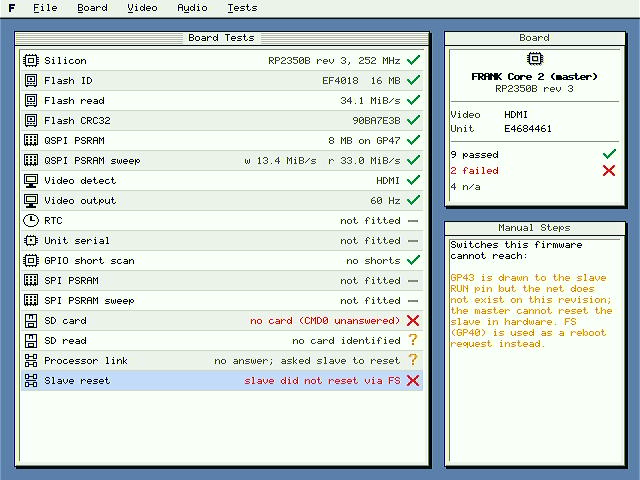
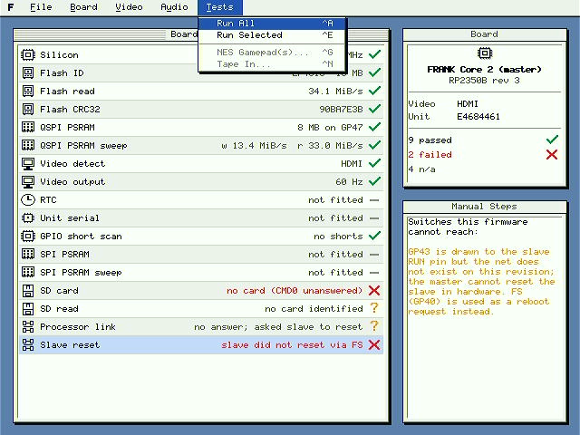
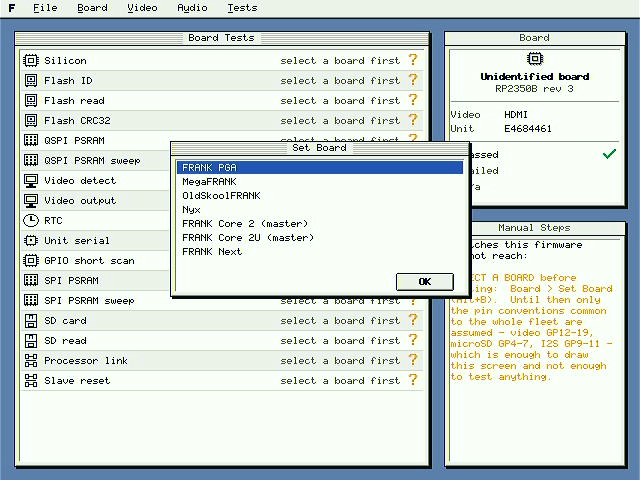
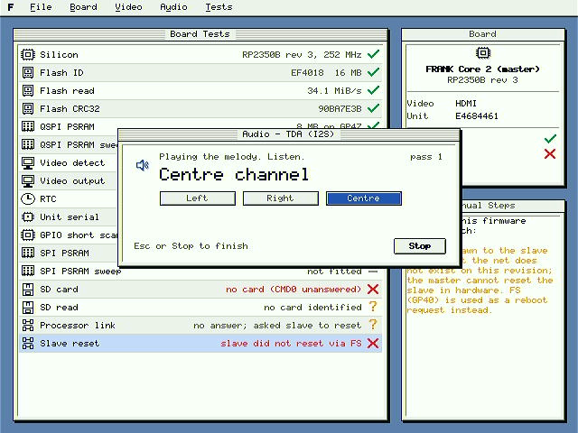

# FRANK Test

Hardware test firmware for the FRANK family of RP2350 retro-computer boards. One
image works out which board it is running on, figures out what that board
actually has, and tests only that.



---

## Contents

- [What it is](#what-it-is)
- [Supported boards](#supported-boards)
- [Getting started](#getting-started)
- [The interface](#the-interface)
- [Board detection](#board-detection)
- [Video](#video)
- [The tests](#the-tests)
- [Interactive checks](#interactive-checks)
- [Saving a report](#saving-a-report)
- [What it cannot test](#what-it-cannot-test)
- [Building](#building)
- [Releases](#releases)
- [Repository layout](#repository-layout)
- [Contributing](#contributing)
- [Attribution](#attribution)
- [Licence](#licence)

---

## What it is

FRANK boards all follow the Murmulator pin conventions, but they differ in
silicon, memory, connectors and audio. Keeping a separate test firmware for each
one meant a dozen nearly identical images, and they drifted apart.

This is one image for all of them. It identifies the board and says how sure it
is. It gates every test on what that board declares, so a peripheral the board
does not have reports **n/a** instead of failing. It keeps *could not run*
separate from *failed*, because those mean different things to whoever is holding
the board. And it prints what it measured: clock rates, chip IDs, throughput,
capacities. Not just a tick.

The interface is a windowed desktop at 640×480 with HDMI, VGA and composite
output, driven entirely from the keyboard. Where the output cannot carry it —
composite, and PIO HDMI on the PiZero — it draws the same information as a text
page instead of a shrunken copy of the desktop.

---

## Supported boards

| Board | MCU | Notes |
|---|---|---|
| FRANK | RP2350A (Pico 2 socket) | DIP-gated tape input |
| FRANK PGA | PGA2350 module | |
| MegaFRANK | RP2350B | TurboSound, SPI PSRAM, RTC, unit serial |
| miniFRANK | RP2350A | DIP-gated tape input |
| microFRANK | RP2350A | |
| zeroFRANK | RP2350A | |
| OldSkoolFRANK | PGA2350 module | DB9 gamepads, TDA1545A into an LM358. VGA by default — the socket is chosen by solder jumpers the firmware cannot see |
| FRANK Core 2 | RP2350B + RP2350A | Inter-processor link. One descriptor covers Core 2 and Core 2U; the U revision adds tape and a USB hub |
| FRANK Next | RP2350B + RP2350A | Inter-processor link, same as the Core 2's. TLV320 codec, SDIO 4-bit card, ESP8266 on the console UART |
| Waveshare RP2350-PiZero ("Z0pa") | RP2350B | HDMI on GP32-39, driven from the PIO; optional PCM5122 audio hat |
| xt8086 | RP2350B + 8086 | The RP2350 is the 8086's whole chipset, so GP0-29 are a CPU bus. VGA only, on GP30-37; one PWM pin for sound |

An unidentified board still boots and draws the screen. It assumes only the
conventions the whole fleet shares: video on GP12-19, microSD on GP4-7, I²S on
GP9-11. That is enough to show you an interface and deliberately not enough to
test anything.

---

## Getting started

1. Pick the image for your silicon from the table below.
2. Hold **BOOTSEL**, connect USB, and drop the `.uf2` onto the drive that
   appears.
3. Connect a display. HDMI is the default; see [Video](#video) for the others.
4. Attach a USB or PS/2 keyboard.
5. Press **S** and pick your board.
6. Press **A** to run everything.

### Which image

The test firmware is one program that works out which board it is on at run
time, so the only thing a build has to get right is the **package**. Get it
wrong and it does not misbehave subtly, it hard-faults on the first access to a
GPIO the package does not have.

| Board | Image |
|---|---|
| miniFRANK, microFRANK, zeroFRANK | `rp2350a` |
| MegaFRANK | `rp2350b` |
| OldSkoolFRANK | `rp2350b` — a PGA2350 is always the B package |
| Waveshare RP2350-PiZero ("Z0pa") | `rp2350b` — its HDMI is on GP32-39, which only the B package has |
| FRANK PGA | `rp2350b` — a PGA2350 is always the B package |
| FRANK | whichever module is in the socket: a Pico 2 is `rp2350a`, a Pico Plus 2 is `rp2350b` |
| FRANK Core 2, Core 2U — master | `rp2350b` |
| FRANK Core 2, Core 2U, FRANK Next — slave | `slave` |
| FRANK Next — master | `next` — the same program as `rp2350b`, with the console moved |
| xt8086 | `xt8086` — the same program as `rp2350b`, with the console moved |

The slave image is a different program: the link peer the master talks to. Flash
it to the second chip of a Core 2, Core 2U or FRANK Next, or "Processor link" and
"Slave reset" will correctly report that nothing answered. One image covers all
three, because their slave halves are pin-identical.

The `next` and `xt8086` images are not different programs — everything peculiar
to those boards is in their descriptors, which is where board differences belong.
The one thing a descriptor cannot move is the console UART, because stdio is up
long before detection runs, and `rp2350b` puts it on GP0/GP1. On xt8086 those are
the 8086's AD0 and AD1; on FRANK Next they are the microSD's CMD and CLK. The
generic image would drive two lines of a live CPU's address bus with every
`printf` in the first case and the card's command line in the second. Each image
is the same firmware with its console where its own header says: GP44/GP45 for
xt8086, GP46/GP45 for FRANK Next.

---

## The interface



Everything is reachable from the keyboard. Some boards in this fleet have no
pointing device at all, so that is not a nicety.

| Key | Action |
|---|---|
| `Alt`+`F` `B` `V` `U` `T` | Open the File, Board, Video, Audio or Tests menu |
| arrows | Move within a menu or the test list |
| `Enter` | Activate; on the list, run the selected test |
| `Esc` | Close a menu or dialog |
| `F1` | Every shortcut, on screen |
| `S` | Set Board |
| `A` | Run All |
| `E` | Run Selected |
| `Y` | Keyboard test |
| `?` | Key help on the console |

`F1` is the one to remember. It lists the rest, works with a menu open, and
closes on any key. It matters most on the outputs that draw a text page: those
render menus as a plain list with no column for the equivalents, so the bare
letters existed there and nothing said so — on boards most likely to be driven
from a keyboard with no mouse at all.

Held arrows and PgUp/PgDn repeat. USB HID reports which keys are *down* rather
than when they were pressed, so a held key used to produce exactly one keystroke —
fine for a menu, useless for scrolling. Enter and Escape deliberately do not
repeat.

A mouse works if you have one. The pointer is drawn by patching the framebuffer
in place rather than recomposing the screen, so it keeps up even while audio is
playing.

Enter BOOTSEL has no keyboard shortcut, on purpose. It is the one command that
ends the session, and a stray keypress used to trigger it.

The clock sits at the right end of the menu bar, on the two boards that carry a
DS3231, and nowhere else. Hours and minutes only: there is no back buffer, so
anything that changed once a second would shimmer across the top of a screen
someone is trying to read a result on. A board with no RTC shows an empty corner
rather than an invented time, for the same reason the report does.

### Reading the results

| Mark | Meaning |
|---|---|
| ✓ | Passed, with the measurement next to it |
| ✗ | Failed. The board has this hardware and it did not work |
| — | n/a. The board has no such hardware, which is not a defect |
| ? | Could not run. The result is unknown, which is not the same as bad |

The *Manual Steps* panel lists switches and jumpers the firmware cannot reach.
On a board with an audio mux or a tape jumper it can exercise the software half
of the path and not the analogue half. Saying so is the difference between a rig
you can trust and one you cannot.

---

## Board detection

Four tiers, each narrowing the field. The verdict comes with its confidence
attached rather than being presented as fact.

**Silicon.** `SYSINFO_PACKAGE_SEL` separates RP2350A from RP2350B. Chip revision
and unique ID come from the same place, then flash JEDEC ID, then PSRAM presence
and size.

**Inventory.** A DS3231 at 0x68, a TLV320 codec, a DS2401 silicon serial. Each is
on some boards and not others. The I²C sweep tries each candidate's bus in turn
and stops at the first that answers, which is a safety property as much as a
saving: bit-banging a bus onto pins that are something else on the board in front
of you drives them. Three pairs are in the table and none is idle elsewhere:
GP28/GP29 is MegaFRANK's and FRANK PGA's but FRANK Next's link clock, GP2/GP3 is
FRANK Next's but xt8086's AD2 and AD3, and GP38/GP39 is xt8086's but FRANK Next's
other link clock. Every board answers on its own pair first, so in practice none
reaches another's.

**Fingerprint.** Pins get pulled up, released, and classified by how they settle.
Scoring is a *ratio* of pins matched, not a count, so a board with seven
signature pins cannot beat a board with six just by having more of them.

A signature is only as good as what it was written from, and the generator that
produces `docs/pinouts.txt` prints one hop. `GPIO0 -> R10[1K].pin1` says a 1K
resistor is on that pin and nothing about where its other end goes.
OldSkoolFRANK's went to the 3V3 rail, was read as a series resistor into the PS/2
connector, and its four most distinctive pins were recorded as floating when they
are held high — which made the board match FRANK PGA's signature completely and
its own barely at all. It reported itself as a FRANK PGA. What separates them is
the ESP-01S strapping: OldSkoolFRANK alone brings GPIO2 and GPIO0 back to GP23
and GP24, and does it with pull-ups on the carrier, so they read high with no
module fitted.

**The operator.** When two descriptors tie the firmware says so and asks, instead
of picking one and being quietly wrong. Two boards that test identically are not
worth a question, though: Core 2 and Core 2U shared a pin map exactly and were
asked about on every board of the type, so they are one descriptor now and the
tie is gone.



Your choice is not written to flash. A stored answer is invisible, it survives
you changing your mind, and it follows the firmware rather than the board when an
image gets moved. A reset starts again from what the hardware says.

---

## Video

Five backends, all 640×480, chosen at boot or from the Video menu.

| Mode | How | Notes |
|---|---|---|
| HDMI | HSTX, TMDS | Default. `clk_hstx` at 126 MHz |
| HDMI | PIO, TMDS | For connectors HSTX cannot reach — see below |
| VGA | HSTX, raw 8-lane | Same GP12-19 pins through the resistor ladder |
| VGA | PIO, raw 8-lane | For ladders HSTX cannot reach — xt8086's, on GP30-37 |
| Composite | PIO software encoder | PAL/NTSC, 320×240 |

HSTX is wired to GP12-19 on the RP2350 and nowhere else, which is fine for every
FRANK board and wrong for two others: the Waveshare PiZero, whose HDMI connector
is on GP32-39, and xt8086, whose VGA ladder is on GP30-37. Both are served by PIO
drivers instead, vendored from murmnes. Each mode is claimed by more than one
backend and every backend refuses the pin bases it cannot drive, so the
descriptor's `video_base` is what decides — the HSTX paths are better where they
work and are tried first.

Refusing is not a formality. On xt8086 the pins HSTX would drive are the 8086's
AD12-A19, so a backend that came up anyway would not merely leave the socket dark
— it would clock a video signal into a live CPU's address bus. Every backend now
checks the base against the one it was built for and declines exact mismatches,
including the composite one, which is the last resort of `ui_video_open()`'s
second pass and would otherwise have been the fallback that did it.

Hold **H**, **V**, **C** or **A** (auto) during the two-second window at boot.
Choosing from the Video menu instead reboots, because the boot path is the only
code path that has ever been tested for bringing a backend up.

**OldSkoolFRANK comes up on VGA**, and it is the one board where a descriptor
outranks the detector. Its HDMI and VGA sockets are the same eight pins — GP12-19
through 220R, with JP3/JP4/JP5 shorting each colour's differential pair into one
DSUB-15 line — so no probe can tell which socket is live, and the detector's
answer was the fleet's HDMI default with a measurement's authority attached. A
board jumpered for VGA came up on an empty HDMI socket because of it. Hold **H**
at boot for the other one. (The two resistors per colour are equal rather than
weighted, so that ladder gives three levels per channel and not four — greys are
coarser here than on MegaFRANK.)

Nothing about video is written to flash. The menu's request rides a watchdog
scratch register across the reboot that applies it and is consumed there, so a
power cycle always comes back on whatever the board actually has. This is
deliberate: a stored mode outranks detection and lives in a sector `picotool
load` does not erase, so a board told once to use VGA kept coming up VGA no
matter what was flashed onto it afterwards, silently. A deliberate choice is
cheap to repeat; a wrong one that survives reflashing costs an evening.

Composite does not get the desktop, and cannot. A composite line carries
somewhere around 320 usable samples however you arrange the source, and 6-pixel
type resampled to fit stops being type. It renders its own text page instead: 42
columns by 30 rows at native resolution, same information, actually legible.

The two PIO paths scan a 320×240 framebuffer doubled to 640×480, so they have the
same problem and take the same answer — the text page, 53 columns by 30 rows
there. Menus, the board picker and every dialog are drawn on it, which they have
to be: on those outputs there is nothing behind them, so an unidentified board
would otherwise have no way to reach Set Board and no way to run anything.

Menu items enable only when the board has the connector *and* this firmware has a
backend for it. An enabled control that quietly falls back to something else is
worse than a greyed-out one.

---

## The tests

### Silicon and memory

| Test | What it proves | What it does not |
|---|---|---|
| Silicon | MCU class, revision, unique ID, system clock | |
| Flash ID | JEDEC manufacturer and device ID, capacity | Anything about the contents |
| Flash read | Sustained XIP read throughput | |
| Flash CRC32 | A CRC over the image, so you can tell what is loaded | |
| QSPI PSRAM | The chip answers on its chip select, and its size | |
| QSPI PSRAM sweep | Write and verify across the whole part | |
| SPI PSRAM | MegaFRANK's second, bit-banged PSRAM: manufacturer ID | Needs S10 closed |
| SPI PSRAM sweep | One block per 64 KiB, seeded from the address | |

The memory benchmarks run before video starts. HSTX scanout fights XIP for the
same bus, and measuring afterwards understated flash throughput by a factor of
four. That number looked like a hardware fault for a while.

Each sweep block is seeded from its own address, so a block read back from the
wrong place fails instead of matching by luck. That is what catches a dropped
address line.

### Board peripherals

| Test | What it proves |
|---|---|
| Video detect | Which output the detector chose, and why |
| Video output | Frames are being emitted, by counting them |
| I2C bus scan | Every address from 0x08 to 0x77, and that both lines idle high |
| Tape switch | Whether the DIP actually connects the tape line to the pin |
| RTC | A DS3231 that is ticking, not merely acknowledging |
| Clock accuracy | The system crystal against the RTC's, in ppm |
| Unit serial | The DS2401 ROM, the only per-unit identity here that is not a guess |
| GPIO short scan | Adjacent-pin solder bridges |
| USB host | What has enumerated: vendor, product and kind |
| USB hub | That a device reached the controller through it |
| ESP 8266 | The companion answers AT, and names its firmware |

The RTC row reads the seconds register twice a second apart, because a DS3231
with a dead crystal or a flat cell acknowledges perfectly — the old row passed on
exactly the clocks that cannot keep time. It reports the oscillator-stop flag and
deliberately does not clear it: clearing is how you acknowledge the stored time is
untrustworthy, and that is the operator's call.

Clock accuracy exists because the system crystal has no reference to be wrong
against — every timer and baud rate is derived from it. The DS3231 has one, and a
good one. The row names both crystals rather than picking a culprit.

The USB hub row needs nothing of its own: every device on Core 2U sits behind the
hub, so anything that enumerated is proof it works.

A short scan confirms a bridge in both directions now — drive high and watch it
follow, then drive low and watch it follow. A floating pin holds charge from
whatever last drove it and can read high once against a pull-down, which produced
a short on the first run after reset that was gone by the second.

The short scan skips pins that are tied together on purpose. The link buses run
adjacent pins to the same places by design, GP9-11 are joined by the audio
network, and driving the link's control lines resets the slave. Flagging those
every run would just teach you to ignore the result.

It also skips a host CPU bus where the descriptor declares one, and that skip is
there to stop a test rather than to avoid a false positive: on xt8086 the sweep's
neighbour is an 8086's address bus. The row says how many pairs it actually
tested, so a board where most pins are spoken for reports a smaller number rather
than the same reassurance as a board where none are.

### Storage

| Test | What it proves |
|---|---|
| SD card | CMD0/CMD8/ACMD41 succeed, and CID and CSD decode to manufacturer, product and capacity |
| SD read | Sector 0 comes back carrying a boot signature |
| SD speed | Read throughput, over the hardware SPI |
| SD write | A sector written, verified, and put back |

Two rows, because they fail for different reasons. Sixteen bytes of CID can
succeed over a link that falls apart at 512. An unformatted card reports *could
not run* rather than failing, since that is not a board fault.

The probe is bit-banged deliberately — it moves about forty bytes and cannot leave
a half-configured peripheral behind it — but *SD speed* hands the same four pins
to the SPI block for the duration, because timing the bit-banged path would
measure this firmware's inner loop and call it a card.

*SD write* takes the last sector, writes a counting pattern, reads it back,
restores the original and reads once more to confirm the restore took. It is the
only row that writes anything, and the only direction the others never exercise.
A failed restore is reported louder than the original fault, because the card
then holds something nobody chose. The pattern counts rather than repeating, so a
stuck bus cannot match it.

### Inter-processor link (Core 2 / Core 2U / FRANK Next)

| Test | What it proves |
|---|---|
| Processor link | Handshake, then bidirectional throughput. Typically around 96 MiB/s duplex |
| Link soak | Thirty seconds of sweeps, counting errors against passes |
| Slave reset (FS) | The master can ask the slave to reboot over the wire, and watch it come back |
| Slave reset (RUN) | The master can hold the slave's RUN pin low, and it stops answering while held |

All need the slave image running. The link stack escalates recovery on its own:
an FS request every second failure, a RUN pulse every fourth where the board has
the pin. A slave that boots late or gets reflashed has to be noticed rather than
forced into step.

The two reset rows are not the same test twice. **FS** proves the slave's
*firmware* is listening — it samples that line from a timer interrupt and reboots
itself — which is the only reset a Core 2 has and is no help at all against the
failure worth recovering from: a slave in lockup with interrupts off, where no
message on any wire arrives anywhere. **RUN** proves the *copper* arrives, and it
is the only thing that reaches a slave in that state.

FRANK Next is the first board to route it. The Core 2 schematic draws GPIO43 to
the slave's RUN and the net is not in the copper, so that board gets the FS row
and an n/a. The RUN test probes *while the pin is held low*, which is what makes
it able to say so: a slave that keeps answering with its reset asserted is not a
slow slave, it is a pin that goes nowhere, and the row says `net open` rather
than failing vaguely.

It is the slowest row in the run, deliberately. A RUN reset is a cold boot, so
the slave does not know it was asked and sits out its full console-attach window
on the way up — about seven seconds before it can answer anything, against well
under one for an FS reboot.

---

## Interactive checks

Some things cannot be tested by a machine with no way to observe the result.
Nothing on a FRANK board can hear its own audio or read back a write-only shift
register, so a PASS in the results list would be a claim the firmware has no
business making. These are dialogs you drive yourself.

### Audio, `Alt`+`U`



PWM, TDA (I²S), TurboSound, PCM5122 and the TLV320's two outputs. Each loops a
short melody through left, right and centre, naming the channel while it plays.
One steady tone cannot tell a working stereo path from a stuck LRCK. They all
sound like success.

*I hear it* and *Silent* record what you decide, and the answer goes into the
saved report. Leaving with `Esc` records nothing, because closing a dialog is not
a verdict and storing it as one would turn "did not check" into "does not work".

**PCM5122** is the audio hat for the Waveshare PiZero, and the only audio path
here whose hardware is optional. The board declares that it can take one, not
that one is fitted, so the menu item is always live and the dialog says plainly
when nothing answers at 0x4C rather than opening and closing again. The hat moves
I²S to its own pins — data GP21, BCK GP18, LRCK GP19 — and needs its DAC
configured over I²C first: it wires no master clock, so the PLL has to be
referenced to the bit clock and the missing-SCK error ignored. Miss either and
the part acknowledges every write and stays silent.

**TLV320** is FRANK Next's codec, and the only one here with two outputs worth
asking about separately: a stereo headphone pair and a mono Class-D speaker amp,
separate blocks with separate power bits and separate ways of being dead. They
are two menu entries, brought up one at a time and recorded as two verdicts,
because one question asked about two outputs is how a working headphone jack
gets written down as a working speaker. The speaker makes one pass rather than
three — its amp is fed from the left output mixer alone, so a right-channel pass
on it would be silence by construction, and asking someone to listen for a
channel the hardware cannot reproduce is how *Silent* gets pressed about a
speaker that works. Neither output makes a sound until it has been configured
over I²C, and the register sequence for both comes from the datasheet rather
than from a firmware that has been heard to work; a codec with the wrong PLL
settings acknowledges every byte and stays perfectly silent, so the operator's
answer is the result and the acknowledgement is not.

**TurboSound is silenced during start-up**, before anything else claims the pins.
An AY comes out of reset with its registers undefined, and nothing on these
boards resets it except the R bit in the 74HC595 word — so a board that was making
a noise when the reset button was pressed carried on making it, through the
reboot, until something wrote to the chips.

**The TDA on OldSkoolFRANK is a TDA1545A**, not the fleet's TDA1387, and the two
disagree about which half of the frame is which. I²S selects the left channel
with word select low; the TDA1545A takes the older simultaneous/EIAJ convention
and selects the right. Same bitstream, opposite speakers — which is exactly what
it sounded like. The descriptor sets `i2s_lr_swapped` and the two labels are
exchanged where the pass is composed, leaving `i2s_tone()`'s packing alone
because that is correct for I²S and was got wrong once already.

It is a fact about the part and not about the board: the path from the DAC to the
jack was traced end to end and is conventional — U7's IOL reaches the tip through
U6B, IOR reaches the ring through U6A, and on a TRS jack tip is left. The
PCM5122 hat and FRANK Next's TLV320 are unaffected; both are ordinary I²S
whatever board they sit on.

**PWM on xt8086** is the whole of that board's sound and reaches it differently
from everywhere else. On the FRANK boards PWM is the fourth input of the audio
mux, a pair of pins that are the I²S ones wearing another function; on xt8086
there is no mux and no DAC, just GP46 into a set of links. So it makes one pass
rather than three, is named *Mono* rather than *Left*, and the dialog says which
link to move — JP1 sends it to the HDMI converter's analogue input, JP2 to the
3.5 mm jack, JP3 and JP4 to the buzzer. Listening at the jack with the link set
to the buzzer sounds precisely like a dead output.

On a board with an audio mux the dialog tells you which switch positions that
source needs. The mux is a 4:1 selector rather than two enables, so setting both
switches picks ground. That is silence, and it looks exactly like a dead
amplifier.

### Keyboard, `Tests` ▸ `Keyboard` (`Y`)

A keyboard drawn on screen, each key turning green while it is held. Both a USB
and a PS/2 keyboard feed it, and it does not distinguish them — the question is
whether the key works.

This is what a byte count cannot answer. A membrane with one dead row, a stuck
key holding a line down, two keys wired to the same code: all of those produce a
perfectly healthy byte count. Pressing every key and watching the right one
answer is the only way to find them.

The traffic counters sit underneath for a reason. A key that never lights has two
explanations, and they separate them: no bytes at all is a dead port, bytes
arriving with nothing lighting is a keyboard talking in codes this table does not
have. There is no numeric pad and no F-row above `F1`, because plenty of
keyboards do not have them and a key that cannot be pressed reads as a fault.
`Esc` closes the dialog on *release*, since it has to light like every other key.

### PS/2 ports, `Tests` ▸ `PS/2 Ports` (`K`)

Press keys and move the mouse; the byte count climbs. The count is deliberately
the raw one, taken before decoding, because a port carrying garbage is wired but
wrong — clock and data crossed, usually — and looks identical to a dead one if you
only watch decoded keys. The last raw code sits beside it: a port showing `0xAA`
and nothing else has a keyboard that finished its self-test and a host that is not
hearing keystrokes.

Those connectors are a common cold-solder site, which is what this is for.

A USB keyboard is counted too, on a line under both panels: key events and the
last HID usage ID, alongside the PS/2 byte count. This check used to be PS/2 only,
which made it useless on the boards whose only keyboard is USB — most of them
now. HID gives usage IDs rather than scancodes, so there is no second byte stream
to show; the useful comparison is against the numbers above it.

The mouse panel names *why* it is off when it is — no pins on this board, or the
console holding GP0/GP1 — because those send you to completely different places.
It reads the PS/2 mouse directly rather than through the merged pointer, so a USB
mouse moving the cursor cannot make a dead PS/2 port look alive.

### LEDs, `Tests` ▸ `LEDs`

The plain LED blinks three times, then a WS2812 fades up and down through red,
green and blue. A board with only one of the two runs only that part.

Fading rather than switching, because a fade is much harder to fake: a marginal
data line usually still manages full brightness and falls apart in the middle of
the range, where a bit error turns a dim red into a bright green.

### Burn-in, `Tests` ▸ `Burn-in`

The whole suite on repeat, counting failures per row and showing only the rows
that have gone wrong — a clean burn-in is a blank panel, and anything on it is
worth looking at. This is the only thing here that catches the class of fault a
single cold pass never will: PSRAM that fails once warm, a link that degrades, a
joint that conducts until something expands.

*Could not run* is counted separately from failure. An empty SD socket is not an
intermittent fault, and lumping the two together would bury a real one under forty
of them. There is no cycle limit: you are the only party who knows how much
evidence the board needs.

### Overclock auto-test, `File` ▸ `Overclock Auto-test`

Every clock above the one the board is running is tried in turn, one reboot each,
and soaked with the flash CRC, a PSRAM sweep and an SRAM pattern check. The run
stops at the first clock that does not hold and reports the highest that did.
Eight or nine rungs at thirty seconds each is about five minutes.

What it reports is *the highest clock that survived N seconds*, not the maximum
stable overclock, and the difference is not pedantry. Thirty seconds finds the
clocks that are grossly wrong — QSPI timing fallen over, PSRAM reading back
short, the core faulting. It cannot find the one that fails after forty minutes
in a warm case. Burn-in asks that question, for as long as you are willing to
wait.

Core voltage is chosen once and held for the whole run. Searching clock and
voltage together is a two-dimensional problem with a reboot per point, and it
would report a pair as though the second number were free — when raising the core
voltage is the part of an overclock that costs you silicon. Run it again at a
higher voltage if that is a trade you want to make.

Nothing is stored. Each candidate rides the same one-boot mechanism `Clocks and
Voltage` uses, and the watchdog is armed before the clock moves — so a candidate
that cannot start resets the board, which comes back at stock and records it as a
failure. The worst case left is a hang the watchdog cannot reach, which costs a
power cycle and abandons the run. No state this writes can stop a board booting.

### Date and time, `Board` ▸ `Set Date and Time`

Only on MegaFRANK, FRANK Next and xt8086, and only when the DS3231 answered. Five fields,
seconds written as zero.

Opening on the time the part already holds means pressing `Enter` with nothing
changed writes the same time back and clears the oscillator-stop flag with it —
which is the "just reset the power-loss bit" case, using the control that was
already there. The flag is never cleared automatically: it is the only evidence
that a coin cell has gone flat, and the RTC test reports it as such.

There is no NTP. The two boards with an RTC and the boards with a network
interface are disjoint sets except FRANK Next, whose ESP8266 runs firmware this
repository does not own.

### NES gamepads, `Tests` ▸ `NES Gamepad(s)`

Both ports drawn schematically, with each button lighting up as you press it and
named underneath. A row saying "gamepad: PASS" cannot mean anything. A row saying
"0x21" means something to nobody.

### Tape in, `Tests` ▸ `Tape In`

The CD4069 squares the incoming audio into digital edges, and this counts and
times them. The display is a ZX Spectrum loading stripe, which is not decoration:
a Spectrum paints one border band per tape pulse, so band thickness *is* pulse
length. Thick red and cyan bands mean pilot tone. Thin blue and yellow mean data.
A picture that stops moving means nothing is arriving. You do not have to read a
number to see any of that.

---

## Saving a report

`File` ▸ `Save Report to SD` writes the run to the card: board, silicon, chip ID,
DS2401 serial, every row with its state and measurement, the summary, and
anything the audio dialogs were told by ear.

The file is named for the DS2401 serial where the board has one, since that part
exists to give a board a permanent name, and falls back to the flash unique ID
where it does not. Runs are appended rather than overwritten, so a unit tested
twice shows both.

The timestamp comes from the DS3231 where there is one and says so plainly where
there is not. Four boards carry an RTC; a report that invented a date on the rest
would be worse than one admitting it has none, because a plausible wrong date is
the kind of thing that gets believed later.

This is the one feature that brings in a filesystem. The tests deliberately do
not use one — whether a card carries a filesystem this firmware recognises says
nothing about whether the board works — so it is invoked from a menu rather than
dragged in by every run. Long filenames and exFAT are compiled out to keep it
small, which means **an exFAT card cannot be written to**; the dialog says so
rather than reporting a vague failure. FAT16 and FAT32 are fine.

---

## What it cannot test

Worth being blunt about, because a rig that quietly claims coverage it does not
have is worse than one that owns up.

Anything past an audio pin. There is no loopback and no ADC. The firmware can
prove SCLK and LRCK are clocking and nothing whatsoever about the DAC, the
amplifier or the speaker.

The AY chips. Verified against the schematic rather than assumed, and it is
worse than write-only: the data bus carries both AYs and the shift register's
outputs with no GPIO on it, the second register's serial output is not connected
to anything, and both output-enables are tied to ground so the chain cannot be
tri-stated to let an AY drive the bus. The audio route was checked too, and the
divider into the tape input puts an AY's output well under the threshold. So
TurboSound is reported by ear, from the Audio dialog, and the saved report says
whose verdict it is.

One track would change that: routing the last register's `QH'` to a spare GPIO
would make everything up to the AY pins testable.

Whether a display is plugged in. No FRANK board wires hot-plug detect, so an
absent monitor and a broken output look identical. *Video output* counts frames
scanned out — from the video driver's own interrupt, not from the firmware asking
for a repaint — and claims nothing more.

Switch positions. Every board has switches the firmware cannot read, and they are
listed in *Manual Steps*. The one exception is the tape DIP, which does not
present a position but does connect a 10K load to GP22 when closed — so *Tape
switch* reports whether it is closed rather than what it is set to.

Composite lock. The encoder can be shown to run. Whether a television syncs to it
is something only a television can tell you.

Whether an LED lights. Firmware can drive a pin and cannot see light, which is
why the LED check is a dialog with no verdict rather than a row.

**The 8086 on xt8086.** Nothing here starts it, and that is a decision rather
than an oversight. The CPU has no oscillator of its own — its clock comes from
GP29 — so with the firmware leaving that pin alone it executes nothing and its
bus stays in the high-impedance state it powers up in, which is exactly what lets
the rig test the board's memory, storage, video, clock and USB without a second
chip fighting it for thirty GPIOs. The descriptor claims GP0-29 so the pin-short
sweep skips them, and the report says the board has a host CPU and that it was
not exercised. A liveness test is possible and is the obvious next thing: hold
RESET, drive a clock, release, and count ALE pulses. It is not here because it
has not been run on hardware, and a test that has not been is not evidence.

Twenty-two of the thirty-three capability bits are tested or interactively
covered today. The two new ones are xt8086's: `CAP_AUDIO_PWM` is covered by the
Audio dialog, and `CAP_HOST_8086` is the untested one described above.
[docs/ROADMAP.md](docs/ROADMAP.md) goes through the rest: what a test could
honestly prove, what it could not, and a sensible order to do them in.

---

## Building

You need the [Pico SDK](https://github.com/raspberrypi/pico-sdk) 2.x and the Arm
GNU toolchain. `sdk_env.sh` finds the SDK, and rejects a stale `PICO_SDK_PATH`
instead of trusting it.

```sh
make build                    # default board (frank_core2_master)
make build BOARD=frank_core2u_master
make flash                    # hold BOOTSEL first
```

Or without make:

```sh
cmake -S app -B app/build -DPICO_BOARD=frank_core2_master
cmake --build app/build -j8
```

### Console

The build is a USB HID host so that keyboards and mice can be tested, and the
RP2350's single USB controller cannot be a CDC device at the same time. So the
console is UART at 115200. For bring-up work, `-DUI_INPUT_USB_HID=OFF` trades the
host for a USB serial console.

On every board with a PS/2 port the mouse sits on GP0/GP1, which is UART0, so the
two cannot both exist. The mouse wins by default: testing that connector is why
it is on the board. Either of these keeps the console instead, and both leave the
PS/2 mouse uninitialised.

| Way | Scope |
|---|---|
| Hold **U** during the boot window | This boot only. Combines with a video key — hold both |
| `File` ▸ `Serial Console` | Stored in flash, so it survives a reflash. Takes effect on the next boot |

The menu item is stored rather than applied on the spot, because the pins are
claimed once during start-up and there is no safe way to hand them back to a UART
underneath a running PS/2 state machine. It is ticked when the console is being
kept.

---

## Releases

`version.txt` holds `MAJOR MINOR` and everything reads it. CMake stamps the
banner and the About box from it, and `release.sh` writes it before building, so
a binary cannot disagree with its own filename.

```sh
./release.sh 1.05
```

That puts four files in `release/`:

- `frank-test_1_05_rp2350a.uf2`, the test firmware for the 30-GPIO package
- `frank-test_1_05_rp2350b.uf2`, the same program for the 48-GPIO package
- `frank-test_1_05_xt8086.uf2`, the same program again with its console moved
- `frank-test_1_05_slave.uf2`, the link peer for Core 2 and Core 2U

The first three are one program that works out which board it is on at run time,
so the split is by silicon rather than by board — the table under
[Which image](#which-image) says which package a board takes, and why xt8086 is
the one board that needs its own build.

---

## Repository layout

```
app/          the test firmware executable and its CMake
core/         board table, capabilities, detection, settings, registry
ui/           4 bpp drawing, windows, menus, icons, video backends
tests/        one file per subsystem under test
common/       the inter-processor link stack, shared with the core2 firmware
drivers/      vendored hardware drivers (see Attribution)
              hdmi_pio/ the PIO HDMI and VGA backends, pcm5122/ the hat's DAC
boards/       Pico SDK board headers for each FRANK variant
slave/        the link peer firmware
screenshots/  captured over HDMI from real hardware
```

`master/`, `probe/` and `selftest/` came along from the frank_core2 firmware this
was branched from. Only `master/src/ui_font.c` is still used.

---

## Contributing

```sh
make hooks    # point git at .githooks
```

This repository's history names the people responsible for it and nobody else.
Commit messages that credit an AI, whether a co-author trailer, a "generated
with" advertisement or a session link, get rejected by the `commit-msg` hook
locally and by the `Attribution` job in CI for everyone else. The local hook only
protects a clone that opted in, and it never runs for a commit made through
GitHub's web interface, so CI is what actually enforces this.

---

## Attribution

This firmware leans on a lot of other people's work. Vendored code keeps its
original authorship and licence, and each file carries a provenance note at the
top.

| Component | Source | Author |
|---|---|---|
| Composite PAL/NTSC encoder (`drivers/tv`) | [frank-msx](https://github.com/rh1tech/frank-msx), from murmnes | Mikhail Matveev, after the Murmulator lineage |
| NES/SNES gamepad PIO reader (`drivers/nespad`) | [pico-infonesPlus](https://github.com/fhoedemakers/pico-infonesPlus) | shuichitakano, fhoedemakers (MIT) |
| SD CID/CSD decode and manufacturer table (`tests/tests_sd.c`) | [SpeccyP](https://github.com/billgilbert7000/SpeccyP), `drivers/pico_fatfs/tf_card.c` | Constantin (billgilbert7000) and contributors |
| FatFs (`drivers/fatfs`) | [elm-chan.org](http://elm-chan.org/fsw/ff/) | ChaN (BSD-style) |
| PIO HDMI and VGA drivers (`drivers/hdmi_pio`) | [murmnes](https://github.com/rh1tech/murmnes) | Mikhail Matveev, after the Murmulator lineage |
| PCM5122 DAC bring-up (`drivers/pcm5122`) | [SpeccyP](https://github.com/billgilbert7000/SpeccyP), `drivers/pcm5122` | Constantin (billgilbert7000) and contributors |
| I²S audio PIO (`drivers/audio_i2s.pio`) | Raspberry Pi Pico examples lineage | |
| USB HID host, XInput (`drivers/usbhid`) | TinyUSB and contributors | |
| HSTX VGA register configuration | DispHSTX | Miroslav Nemecek |
| Adjacent-pin short scan | [murmulator-tester](https://github.com/DnCraptor/murmulator-tester) | DnCraptor |
| TurboSound 74HC595 word format | [SpeccyP](https://github.com/billgilbert7000/SpeccyP), `aySoft.h` | Constantin (billgilbert7000) |

The vendored composite driver needed two edits, both because of how this firmware
allocates its hardware rather than out of preference:

- `PIO_VIDEO` selects pio2. pio0 carries the inter-processor link and pio1 the
  I²S audio.
- The DMA request line now comes from `pio_get_dreq()` rather than a hardcoded
  `DREQ_PIO1_TX0`. That constant predates the RP2350's third PIO and silently
  hands pio2 the pio1 request line.

A third change publishes the encoder's emitted-frame count, which gives *Video
output* something honest to measure.

---

## Licence

GPL-3.0-or-later. See [LICENSE](LICENSE).

Copyright © 2026 Mikhail Matveev, <https://rh1.tech>
